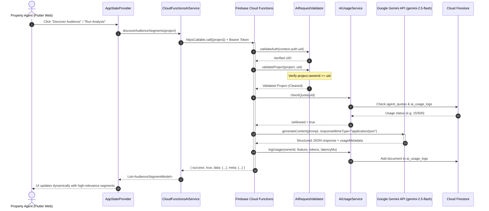

# PropMatch AI — Phase 3.1: Centralized AI Service Architecture

## 1. Executive Summary

PropMatch AI transforms from a manual property management system into an intelligent real estate intelligence platform powered by Google Cloud, Firebase Cloud Functions (v2), and the Google Gemini LLM family. 

To satisfy the **Web-First Development Policy**, **Multi-Tenant Scoping (`Single-Agent First, Multi-Agent Ready`)**, and strict **Malaysian Personal Data Protection Act (PDPA 2010)** requirements, all AI operations are mediated through a secure, centralized serverless backend.

Direct frontend-to-Gemini communication is **strictly prohibited**. The Flutter Web frontend interfaces with Cloud Functions via an abstract service layer (`AIBackendService`) with zero-downtime offline and rule-based fallback capabilities (`LocalRuleBasedAIService`).

---

## 2. High-Level Architecture Diagram

```
+-----------------------------------------------------------------------------------+
|                           PropMatch AI Flutter Web Client                         |
|                                                                                   |
|  +--------------------+   +-----------------------+   +------------------------+  |
|  | AI Audience View   |   | AI Matching View      |   | Marketing AI Assistant |  |
|  +---------+----------+   +-----------+-----------+   +-----------+------------+  |
|            |                          |                           |               |
|            +--------------------------+---------------------------+               |
|                                       |                                           |
|                           [ AppStateProvider ]                                    |
|                                       |                                           |
|                            [ AIBackendService ]                                   |
|                           /                    \                                  |
|         (Cloud Active)   /                      \  (Fallback / Offline / Demo)    |
|                         v                        v                                |
|        [ CloudFunctionsAIService ]     [ LocalRuleBasedAIService ]                |
|                     |                  (AIService & MatchingService)              |
+---------------------|-------------------------------------------------------------+
                      | HTTPS (Firebase Auth Token)
                      v
+-----------------------------------------------------------------------------------+
|                 Google Cloud / Firebase Backend (asia-southeast1)                 |
|                                                                                   |
|  +-----------------------------------------------------------------------------+  |
|  |                       Firebase Cloud Functions v2                           |  |
|  |                                                                             |  |
|  |  +-----------------------------------------------------------------------+  |  |
|  |  | [1. Auth & Multi-Tenant Guard] (AIRequestValidator)                   |  |  |
|  |  |     - Verifies context.auth.uid exists                                |  |  |
|  |  |     - Enforces project.ownerId == context.auth.uid                    |  |  |
|  |  |     - Strips PII (fullName, email, phone) before LLM prompt           |  |  |
|  |  +-----------------------------------+-----------------------------------+  |  |
|  |                                      |                                      |  |
|  |  +-----------------------------------v-----------------------------------+  |  |
|  |  | [2. Quota & Cost Control Guard] (AIUsageService)                       |  |  |
|  |  |     - Checks monthly limits in agent_quotas/{ownerId}                 |  |  |
|  |  |     - Enforces calendar month consumption caps                        |  |  |
|  |  +-----------------------------------+-----------------------------------+  |  |
|  |                                      |                                      |  |
|  |  +-----------------------------------v-----------------------------------+  |  |
|  |  | [3. Gemini Execution Engine] (GeminiService)                           |  |  |
|  |  |     - Primary: gemini-2.5-flash | Fallback: gemini-2.5-pro            |  |  |
|  |  |     - JSON Schema Enforcement (responseMimeType: "application/json")   |  |  |
|  |  |     - Exponential backoff retry (429/503) & 30s timeout safety        |  |  |
|  |  +-----------------------------------+-----------------------------------+  |  |
|  |                                      |                                      |  |
|  |  +-----------------------------------v-----------------------------------+  |  |
|  |  | [4. Output Sanitizer & Logger] (ResponseParser & ErrorHandler)        |  |  |
|  |  |     - Strips markdown fences, validates output JSON schema            |  |  |
|  |  |     - Writes execution telemetry to ai_usage_logs                     |  |  |
|  |  |     - Sanitizes stack traces, returns typed HttpsError                |  |  |
|  |  +-----------------------------------+-----------------------------------+  |  |
|  +--------------------------------------|--------------------------------------+  |
|                                         |                                         |
|                 +-----------------------+-----------------------+                 |
|                 |                                               |                 |
|                 v                                               v                 |
|      [ Google Cloud Secret Manager ]               [ Cloud Firestore ]            |
|      - GEMINI_API_KEY (Strictly isolated)          - users/{uid}                  |
|                                                    - projects/{id}                |
|                                                    - property_analyses/{id}       |
|                                                    - ai_usage_logs/{id}           |
|                                                    - agent_quotas/{ownerId}       |
+-----------------------------------------------------------------------------------+
```

---

## 3. Core Component Breakdown

### 3.1 Backend Architecture (`functions/src/`)

| Module | Location | Purpose |
|---|---|---|
| **Entry Point** | `functions/src/index.ts` | Exports callable v2 functions: `analyzeProperty`, `discoverAudienceSegments`, `matchBuyers`, `generateMarketingContent`, `getAIUsageStats`. |
| **Gemini Engine** | `functions/src/services/gemini_service.ts` | Centralized `@google/generative-ai` wrapper providing prompt templates, structured JSON schema enforcement, model fallback, timeouts, and exponential backoff retry. |
| **Usage & Quotas** | `functions/src/services/ai_usage_service.ts` | Tracks execution metadata in Firestore `ai_usage_logs` and enforces monthly request quotas per agent. |
| **Validation & PDPA** | `functions/src/validators/ai_request_validator.ts` | Enforces authentication, verifies `ownerId == auth.uid`, and sanitizes PII before prompt compilation. |
| **Response Parser** | `functions/src/utils/response_parser.ts` | Strips markdown fences (````json ... ````), handles unquoted strings, and normalizes schema structures. |
| **Error Handler** | `functions/src/utils/error_handler.ts` | Catches exceptions and translates them into secure `HttpsError` objects without leaking backend stack traces or API keys. |
| **Logger** | `functions/src/utils/logger.ts` | Structured JSON logger with automatic redaction of sensitive credentials and contact numbers. |

### 3.2 Frontend Architecture (`lib/services/ai_backend_service.dart`)

The client adopts the abstract service pattern:
- **`AIBackendService`**: Pure Dart contract defining AI operations for Property Analysis, Audience Discovery, Buyer Matching, Marketing Copywriting, and Quota Retrieval.
- **`CloudFunctionsAIService`**: Connects to regional Firebase Functions (`asia-southeast1`). Automatically catches network drops or uninitialized states and routes to `_fallbackService`.
- **`LocalRuleBasedAIService`**: Rule-based offline engine wrapping `AIService` and `MatchingService`. Ensures 100% demo stability and test compatibility without cloud dependencies.

---

## 4. End-to-End Request Lifecycle



---

## 5. Resilience & Graceful Degradation Strategy

1. **Undeployed / Network Offline Fallback**:
   If the Cloud Functions are unreachable or not yet deployed, `CloudFunctionsAIService` intercepts the error and immediately falls back to `LocalRuleBasedAIService`. The user experience never crashes.
2. **Transient Model Overload (HTTP 429 / 503)**:
   `GeminiService` implements exponential backoff retry (up to 2 retries, 1000ms - 2000ms delay).
3. **Primary Model Degradation**:
   If `gemini-2.5-flash` experiences an outage, `GeminiService` automatically switches to the fallback model `gemini-2.5-pro`.
4. **Enforced Timeout (30 Seconds)**:
   Calls exceeding 30 seconds are terminated to prevent hanging client connections.
