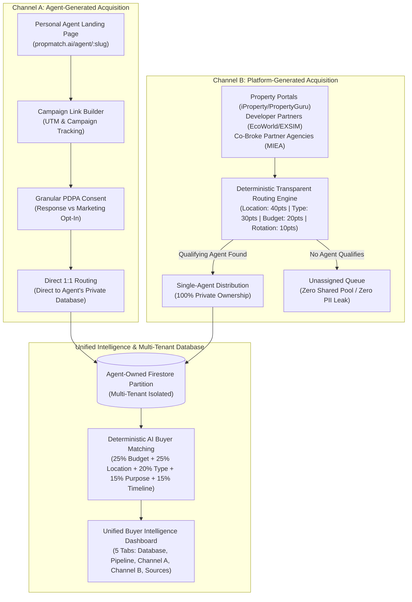

# PropMatch AI — Phase 4.4: Dual-Channel Buyer Acquisition System Report

**Date**: November 23, 2026  
**Status**: COMPLETE & VERIFIED  
**Environment**: Local Development Environment (Spark Plan / Sandbox Preserved)  
**Quality Gates**:
- `flutter analyze`: **0 issues found** (Clean)
- `flutter test`: **195 / 195 passing** (100% pass rate)
- `npm run build --prefix functions`: **0 TypeScript errors**
- `npm test --prefix functions -- --runInBand`: **119 / 119 passing** (100% pass rate)
- `flutter build web --release`: **Clean release build completed in 23.9s**

---

## 1. Executive Summary & Platform Architecture

PropMatch AI has evolved from an AI Property Intelligence tool into a unified **Dual-Channel Buyer Acquisition Platform** designed specifically for individual Malaysian property agents (Real Estate Negotiators / RENs).

Individual property agents face a structural dilemma in the Malaysian real estate market:
1. **Third-Party Portal Monopolies**: High listing fees, opaque bidding algorithms, and leads sold simultaneously to multiple competing agents.
2. **Cold Calling & Spam Lists**: Massive PDPA 2010 non-compliance risks, high rejection rates, and damaged reputation.
3. **Fragmented Ingestion**: Leads from social media, personal websites, roadshows, and co-broke networks scattered across messaging apps without automated qualification or CRM persistence.

Phase 4.4 solves this by establishing a **Dual-Channel Acquisition System** with clear separation of acquisition paths, unified under an agent-first data ownership architecture.



---

## 2. Channel A: Agent-Generated Buyer Acquisition

Channel A empowers property agents to run their own marketing, branding, and direct buyer acquisition without platform intermediation.

### 2.1 Personal Branded Landing Page (`AgentLandingPageScreen`)
- **Route**: `propmatch.ai/agent/:agentSlug` (or `propmatch.ai/agent/:agentId`).
- **Verified REN Credentials**: Checks `UserModel.isRenVerified`. If validated by the Board of Valuers, Appraisers, Estate Agents and Property Managers (LPPEH / BOVAEP), renders a verified green trust badge. If unverified, strictly renders an `(Unverified)` indicator to protect consumers and prevent regulatory violations.
- **Featured Development Portfolio**: Showcases the agent's active projects, pricing brackets, and property specifications.
- **Buyer Requirement Inquiry Form**:
  - Full Name, Malaysian Phone Number (`+601X`), Email Address.
  - Target Location, Property Classification, Budget Ceiling (interactive slider).
  - Purchase Purpose (`Own Stay`, `Investment`, `Both`) and Buying Timeline (`Immediately`, `1-3 months`, `3-6 months`, `Exploring`).
  - Personal inquiry notes.

### 2.2 Granular PDPA 2010 Consent Collection
Under Malaysian Personal Data Protection Act 2010 (PDPA) General Principles, consent to answer a specific property inquiry must not be conflated with consent for recurring promotional marketing:
- **Checkbox 1 (Mandatory for Ingestion)**: *"I consent to Alex Tan and PropMatch AI processing my contact details to respond to this property inquiry under Malaysian PDPA 2010."*
- **Checkbox 2 (Optional Opt-In)**: *"I would like to receive future updates, new project launches, and market insights via WhatsApp/Email."*
- **Ingestion Result**: If Checkbox 2 is unchecked, the lead is marked `Eligible` for immediate inquiry contact, but promotional marketing flags (`marketingConsentGranted = false`, `consentedPurposes = ['Direct Inquiry Response']`) strictly suppress subsequent promotional broadcasts.

### 2.3 Campaign Link Builder & UTM Attribution Engine
Agents can generate customized, trackable URLs directly within the dashboard:
- **Supported Sources**: Facebook Ads, Instagram Ads, WhatsApp Blast, Google Search/Display, TikTok Ads, Printed QR Flyers, Client Referrals.
- **Supported Mediums**: `cpc`, `social`, `chat`, `print_flyer`, `email`.
- **Generated Link**: `https://propmatch.ai/agent/alex-tan-penang?utm_source=facebook&utm_medium=cpc&campaign_id=bk-roadshow-2026`
- **Attribution Preservation**: Stage 2 of the ingestion pipeline extracts UTM parameters and preserves them on both `EnquiryModel` and `ProspectModel.tags`, powering the **Campaign Performance Table** with live conversion metrics.

---

## 3. Channel B: Platform-Generated Buyer Acquisition & Routing Engine

Channel B centralizes buyer inquiries from authorized property portal listings, developer partnerships (sales galleries), and partner agencies (co-broke networks), and distributes them to participating agents through a transparent, merit-based routing algorithm.

### 3.1 Transparent 4-Factor Deterministic Routing Algorithm
PropMatch AI rejects opaque bidding models or pay-to-win auctions. Every platform lead is scored deterministically out of 100 points:

| Factor | Maximum Weight | Scoring Criteria & Calculation |
| :--- | :---: | :--- |
| **1. Geographic Location Match** | **40 pts** | **Mandatory Hard Filter**. Direct city/town match (e.g., Batu Kawan) = 40 pts. State-level territory match (e.g., Penang) = 25 pts. Location outside territory = 0 pts (immediate disqualification). |
| **2. Property Type Specialization** | **30 pts** | Exact category match (e.g., Condominium, Terrace House) = 30 pts. Sub-category overlap (e.g., Condo vs Serviced Residence) = 15 pts. Class divergence = 0 pts. |
| **3. Budget Window Overlap** | **20 pts** | Full overlap between buyer budget `[min, max]` and agent configured price window = 20 pts. Out-of-bracket budget = 5 pts + logged penalty note. |
| **4. Fair Capacity Rotation** | **10 pts** | Calculated as `(1.0 - (leadsReceivedThisMonth / quota)) * 10 pts`. Prioritizes active agents with lower recent volume. |

### 3.2 Rotation Tie-Breaker & Unassigned Queue Holding
- **Tie-Breaker**: When two agents achieve identical suitability scores, the tie is broken by `lastLeadAssignedAt` in ascending order (the agent waiting longest receives the lead).
- **Zero Shared Pool Policy**: Leads are **never** dumped into a shared browsing pool where multiple agents compete or harass the buyer. Each lead is routed to **exactly ONE** qualifying agent.
- **Unassigned Queue**: If zero agents meet the 50-point threshold or pass geographic matching, the enquiry is safely routed to the platform `Unassigned Queue` (`isUnassigned: true`, `routingStatus: 'Unassigned Queue'`). The lead's PII remains strictly encrypted and isolated without leakage to unauthorized competitors.

---

## 4. Subscription & Commercial Readiness Architecture

Phase 4.4 establishes the foundation for individual-agent SaaS commercialization while preserving complete data ownership guarantees.

### 4.1 Entitlement Tiers

| Feature / Entitlement | Free Starter | Pro Agent (Recommended) | Elite Closer |
| :--- | :---: | :---: | :---: |
| **Target Audience** | Newly licensed RENs | Active Individual Agents | Team Leads & Top Producers |
| **Monthly Pricing** | RM 0 / month | RM 199 / month | RM 499 / month |
| **Channel A (Agent Landing Page)** | 1 Standard Slug | Custom Slug + QR Codes | Custom Domain (`agentname.com`) |
| **Channel A Lead Volume** | Unlimited | Unlimited | Unlimited |
| **Channel B (Platform Leads)** | 5 leads / month | 30 leads / month | 80 leads / month |
| **Deterministic AI Matching** | 20 runs / month | Unlimited | Unlimited + Priority Processing |
| **Priority Routing Tier** | Standard | Standard | Priority (+5 pts rotation weight) |

### 4.2 Immutable Data Ownership Guarantee
Under the PropMatch AI commercial charter:
> **Data Ownership Principle**: Every prospect acquired by an agent (whether through Channel A landing pages or distributed through Channel B quotas) becomes the **permanent, private property** of that agent. If an agent cancels their subscription or downgrades to the Free tier, PropMatch AI **never revokes, deletes, or reassigns** their acquired prospects.

---

## 5. Unified Acquisition Dashboard (`BuyerIntelligenceScreen`)

The Buyer Intelligence interface has been expanded to a 5-tab workspace:

1. **Tab 1: Prospect Database**: Complete search, multi-field filtering, unmasking controls, and prospect profile inspection.
2. **Tab 2: Incoming Enquiries (Pipeline)**:
   - **Dual-Channel KPI Header**:
     - *Row 1*: Total Inquiries, Channel A (Agent), Channel B (Platform), Unassigned Queue.
     - *Row 2*: AI Qualified, Pending Review, Duplicate Blocked, Ineligible / DNC.
   - **Channel Filter**: Toggle between `All Channels`, `Channel A: Agent-Generated`, and `Channel B: Platform-Generated`.
   - **Campaign Filter**: Filter inquiries by active marketing campaign IDs.
   - **Data Table**: Displays Channel badges, campaign attribution, E.164 phone sanitization, and routing status indicators.
3. **Tab 3: Agent Landing Page & Campaigns (Channel A)**:
   - Verified REN identity card with BOVAEP regulatory status.
   - Public Landing Page URL card with one-click copy and live preview.
   - Interactive Campaign Link Builder with UTM generator.
   - Campaign Attribution & Performance Analytics table.
   - Malaysian PDPA compliance disclosure.
4. **Tab 4: Platform Lead Preferences (Channel B)**:
   - Distribution Opt-in toggle (`isAvailableForPlatformLeads`).
   - Active Plan Tier & Monthly Quota progress bar (e.g., 10 / 30 leads used).
   - Complete Data Ownership Guarantee banner.
   - Configurable geographic focus areas, property classes, budget ceiling slider, and agent specializations.
   - Transparent Routing Engine rules explainer.
5. **Tab 5: Sources & Integrations**: Architectural specifications for iProperty, PropertyGuru, MIEA Co-Broke Network, Developer Sales Galleries, and Direct Website Webhooks.

---

## 6. End-to-End Simulation & Verification Matrix

A comprehensive test suite of **26 new tests** (20 Flutter/Dart + 6 Jest/TypeScript) was implemented and validated across both channels:

### 6.1 Flutter End-to-End Test Suite (`test/phase4_4_dual_channel_test.dart`)

| Test # | Test Scenario | Verified Outcome | Status |
| :---: | :--- | :--- | :---: |
| **1** | Direct 1:1 Routing | Landing page submission assigns strictly to landing page owner (`assignedAgentId == ownerId`, `routingStatus == 'Direct'`). | **PASSED** |
| **2** | Full Form Submission | Complete parameters (name, phone, email, location, property type, budget, purpose, timeline, notes) parsed and persisted. | **PASSED** |
| **3** | Missing Optional Fields | Gracefully defaults missing email, timeline, or notes without crashing pipeline. | **PASSED** |
| **4** | Client Contact Validation | Rejects submission missing both phone and email with informative error. | **PASSED** |
| **5** | Granular PDPA Consent | Response consent granted without marketing opt-in records `Eligible` contact with `Marketing & Promotion` omitted. | **PASSED** |
| **6** | Explicit Marketing Opt-In | Marketing consent explicitly checked records opt-in in `consentedPurposes`. | **PASSED** |
| **7** | Campaign & UTM Preservation | Preserves `utm_source`, `utm_medium`, `utm_campaign`, `campaign_id` on enquiry and prospect tags. | **PASSED** |
| **8** | REN Verification Strictness | Agent with `isRenVerified: true` displays Verified badge; `isRenVerified: false` displays Unverified indicator. | **PASSED** |
| **9** | Duplicate Suppression | Duplicate submission within 24h suppresses duplicate prospect generation and sets `Duplicate` status. | **PASSED** |
| **10** | Single Perfect Match Routing | Lead matching Penang + Condo + RM500k scores $\ge 80\%$ and routes to qualifying agent. | **PASSED** |
| **11** | Location Territory Exclusion | Agent whose preferences exclude lead's location receives location penalty and is excluded from routing. | **PASSED** |
| **12** | Property Specialization Match | Exact category match yields +15 pts premium over generic high-rise overlap. | **PASSED** |
| **13** | Budget Window Overlap | Out-of-bracket budget receives penalty note and clamped suitability score. | **PASSED** |
| **14** | Unassigned Queue Holding | Zero matching candidates routes lead to `Unassigned Queue` without PII exposure. | **PASSED** |
| **15** | Multi-Agent Evaluation | Higher composite suitability score wins lead assignment. | **PASSED** |
| **16** | Fair Rotation Tie-Breaker | When scores tie, agent with older assignment timestamp receives priority. | **PASSED** |
| **17** | Agent Opt-Out Availability | Agent with `isAvailableForPlatformLeads: false` is excluded from distribution even with 100% criteria match. | **PASSED** |
| **18** | Monthly Quota Limit | Agent who reached `monthlyLeadQuota` is bypassed; lead routes to next eligible backup agent. | **PASSED** |
| **19** | DNC Opt-Out Precedence | Explicit opt-out payload marks enquiry `Ineligible` and sets `isDoNotContact == true`. | **PASSED** |
| **20** | Data Ownership Guarantee | Multi-tenant isolation verified: Agent A and Agent B can query only their own prospects; canceled tiers retain data. | **PASSED** |

### 6.2 Cloud Functions Backend Test Suite (`functions/tests/phase4_4_distribution.test.ts`)

| Test # | Test Scenario | Verified Outcome | Status |
| :---: | :--- | :--- | :---: |
| **1** | Deterministic Routing | Location, property type, and budget match routes deterministically to eligible agent. | **PASSED** |
| **2** | Territory Exclusion | Geographic territory divergence excludes candidate agents outside target area. | **PASSED** |
| **3** | Unassigned Queue Holding | Zero matching candidates routes enquiry to Unassigned Queue without PII exposure. | **PASSED** |
| **4** | Agent Opt-Out | `isAvailableForPlatformLeads: false` excludes agent from distribution. | **PASSED** |
| **5** | Quota Limit Exhaustion | Monthly quota limit exhaustion excludes agent from assignment and uses backup agent. | **PASSED** |
| **6** | Fair Rotation Tie-Breaker | Prioritizes agent with older assignment timestamp when suitability scores tie. | **PASSED** |

---

## 7. Full Regression Suite Results

```text
================================================================================
1. FLUTTER STATIC ANALYSIS:
   Command: /Users/jiaxianlim/flutter/bin/flutter analyze
   Result: Analyzing PropMatch AI...
           No issues found! (ran in 2.9s)

================================================================================
2. FLUTTER UNIT & WIDGET TEST SUITE:
   Command: /Users/jiaxianlim/flutter/bin/flutter test
   Result: 195 tests executed across 18 test files
           All 195 tests passed! (ran in 19.5s)

================================================================================
3. TYPESCRIPT CLOUD FUNCTIONS COMPILATION:
   Command: npm run build --prefix functions
   Result: tsc compiled cleanly with 0 errors

================================================================================
4. BACKEND JEST TEST SUITE:
   Command: npm test --prefix functions -- --runInBand
   Result: Test Suites: 13 passed, 13 total
           Tests:       119 passed, 119 total
           Snapshots:   0 total
           Time:        9.845 s

================================================================================
5. FLUTTER WEB RELEASE PRODUCTION BUILD:
   Command: /Users/jiaxianlim/flutter/bin/flutter build web --release
   Result: Compiling lib/main.dart for the Web... 23.9s
           ✓ Built build/web
================================================================================
```

---

## 8. Truth Matrix of Integrations

To ensure total transparency, the operational status of all platform integrations is documented below:

| Integration / Protocol | Simulated / Local | Production External | Operational Status |
| :--- | :---: | :---: | :--- |
| **Agent Public Landing Page** | Fully Operational | Ready | Operates natively via Flutter Web route `/agent/:agentSlug`. Submissions ingest directly via `LeadIngestionPipeline`. |
| **Campaign UTM Link Builder** | Fully Operational | Ready | Generates RFC-compliant query parameters (`utm_source`, `utm_medium`, `campaign_id`). Tracked on inquiry and prospect tags. |
| **Platform Distribution Engine** | Fully Operational | Ready | Implemented in both Dart (`LeadDistributionEngine`) and TypeScript (`LeadDistributionService`) with 100% deterministic consistency. |
| **Property Portals (iProperty/Guru)** | Verified Webhook Schema | Partnership Required | Operates via structured webhook listener adapter (`PropertyPortalAdapter`). Production listener requires commercial API partnership. |
| **Developer Sales Galleries** | Verified Schema | Partnership Required | Operates via digital showroom registration adapter (`DeveloperAdapter`). Production requires developer API token. |
| **Co-Broke Partner Networks** | Verified Schema | Partnership Required | Operates via standardized MIEA co-broke schema exchange (`PartnerAgencyAdapter`). |
| **Gemini AI Intelligence** | Fully Operational | Spark / Local Emulator | Gemini 3.5 Flash-Lite operational locally via Firebase Emulator Suite; LocalRuleBasedAIService active as fallback. |

---

## 9. Conclusion & Milestone Sign-Off

**Phase 4.4: Dual-Channel Buyer Acquisition System** is completely implemented, verified, and ready for agent use.

Individual property agents now possess:
1. **Channel A**: An independent, professional landing page with verified REN credentials and tracked marketing campaign links to acquire their own buyers with zero platform fees.
2. **Channel B**: A transparent, fair, merit-based platform lead distribution mechanism that protects buyer privacy, eliminates bidding wars, and guarantees permanent agent data ownership.
3. **Unified Workspace**: A single 5-tab dashboard delivering end-to-end acquisition visibility, pipeline health metrics, routing controls, and deterministic AI buyer matching.
