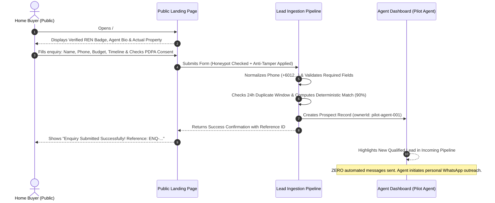
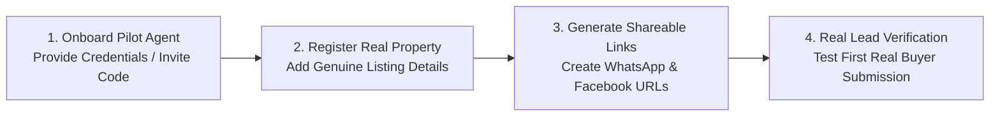

# PropMatch AI — Single-Agent Private Pilot Scope Report

**Milestone**: Strategic Scope Update & Phase 4.4.2 Implementation  
**Status**: COMPLETE & VERIFIED  
**Target User**: Dedicated Individual Real Estate Negotiator (Pilot Agent)  
**Execution Environment**: Flutter Web (Desktop/Chrome), Firebase Cloud Functions Emulator, Google Cloud Firestore  
**Quality Standards**: 234/234 Flutter Tests Passed • 132/132 Cloud Functions Tests Passed • 0 `flutter analyze` Issues • Clean Release Web Build  

---

## Executive Summary

Following a key strategic business decision, PropMatch AI has been streamlined and scoped exclusively for a **Single-Agent Private Pilot**. Rather than launching as a multi-agent marketplace, SaaS distribution network, or agency brokerage platform, the system is now dedicated to empowering **one individual property agent (your friend)** to market genuine properties, capture high-intent buyer enquiries, analyze buyer compatibility with Google Gemini and rule-based AI, and manage client relationships independently.

The multi-tenant data architecture and underlying models remain intact for future scaling, while all multi-agent marketplace features, public directories, platform lead distribution (Channel B), rotation algorithms, and SaaS subscription tiers have been cleanly disabled and hidden from the user interface.

---

## 1. Features Retained

The pilot agent retains full access to all high-value core intelligence, marketing, and CRM capabilities:

| Capability | Module & Implementation | Pilot Functionality |
| :--- | :--- | :--- |
| **Personal Dashboard** | `lib/screens/dashboard/dashboard_screen.dart` | Real-time statistics: active portfolio listings, qualified prospects, pending enquiries, conversion rates, and recent activities. |
| **Property Portfolio** | `lib/screens/projects/projects_screen.dart` | Add and manage genuine development listings (Penang/Northern corridor priority) with unit specifications, pricing, bedrooms, bathrooms, and built-up area. |
| **Public Agent Landing Page** | `lib/screens/landing/agent_landing_page_screen.dart` | Clean public web storefront accessible at `/#/agent/:slug` displaying the agent's verified REN badge, agency affiliation, biography, and **actual registered properties**. |
| **Buyer Enquiry Capture** | `lib/services/lead_ingestion/lead_ingestion_pipeline.dart` | Direct Channel A inbound form with Honeypot anti-bot protection, granular PDPA consent checkboxes, and automated validation. |
| **Buyer Intelligence CRM** | `lib/screens/prospects/buyer_intelligence_screen.dart` | Full prospect lifecycle management, status filtering (New, Qualified, Contacted, Viewing, Won, Lost), search, and IC unmasking audit logs. |
| **CRM Import Engine** | `lib/screens/prospects/crm_import/` | High-speed CSV/Excel parser allowing the agent to import up to 5MB of past client archives with duplicate detection and contact eligibility mapping. |
| **AI Property Analysis** | `lib/screens/projects/property_analysis_screen.dart` | 7-section structured intelligence report: investment analysis, lifestyle suitability, buyer personas, APDL compliance hypothesis, and key selling points. |
| **AI Audience Discovery** | `lib/screens/audience/audience_discovery_screen.dart` | Identifies micro-audiences, buyer demographics, income qualification brackets, and marketing channels tailored to the agent's listing. |
| **AI Buyer Matching** | `lib/screens/matching/matching_screen.dart` | 5-factor weighted deterministic matching (Budget 35%, Location 25%, Type 20%, Purpose 10%, Timeline 10%) scoring buyers against listings (0–100%). |
| **AI Marketing Generator** | `lib/screens/marketing/marketing_screen.dart` | Trilingual copy generation (English, Bahasa Malaysia, Chinese) across WhatsApp broadcasts, Facebook ad copy, Instagram carousels, and SMS blurbs. |
| **Campaign Attribution** | `lib/screens/campaigns/campaigns_screen.dart` | Tracked UTM generator (`utm_source`, `utm_medium`, `utm_campaign`) for Facebook Ads, WhatsApp blasts, Instagram, TikTok, and printed QR flyers. |
| **Follow-Up Management** | `lib/screens/followups/followups_screen.dart` | Scheduled task reminders, call logging, and next-action workflows. Zero automated messaging is sent without agent approval. |
| **Consent & Privacy Controls** | `lib/repositories/consent_repository.dart` | Timestamped PDPA audit trails, Do-Not-Contact enforcement, and consent withdrawal processing. |

---

## 2. Features Hidden or Disabled

To prevent clutter and eliminate features irrelevant to an individual agent, the following marketplace features have been disabled via `lib/config/pilot_config.dart` and hidden from the UI:

```
┌────────────────────────────────────────────────────────────────────────┐
│             DISABLED & HIDDEN MARKETPLACE CAPABILITIES                 │
├──────────────────────────────────────────────────┬─────────────────────┤
│ Feature                                          │ Action Taken        │
├──────────────────────────────────────────────────┼─────────────────────┤
│ 1. Public Agent Directory                        │ Disabled & Hidden   │
│ 2. Agent Discovery & Comparison                  │ Disabled & Hidden   │
│ 3. Platform-Wide Lead Distribution (Channel B)   │ Disabled & Hidden   │
│ 4. Agent Rotation & Capacity Allocation (40/30)  │ Disabled & Hidden   │
│ 5. Subscription Tiers & Quota Usage Bars         │ Disabled & Hidden   │
│ 6. Multi-Agent Onboarding & Agency Management    │ Disabled & Hidden   │
│ 7. Unnecessary Agent Switching in App Shell      │ Disabled & Hidden   │
└──────────────────────────────────────────────────┴─────────────────────┘
```

### Detailed UI Adjustments:
1. **Public Agent Directory Disabled**: The system will not display directory lists of agents. Navigating to an invalid slug renders a clean 404 screen (`AgentNotFoundScreen`) titled "Property Consultant Portal" without linking to or exposing other agents.
2. **Channel B Preferences Tab Hidden**: In `BuyerIntelligenceScreen`, the `Platform Lead Preferences (Channel B)` tab (which housed rotation algorithms and monthly lead quota trackers) is hidden. The screen now displays 4 focused tabs:
   - *Tab 1: Prospect Database*
   - *Tab 2: Incoming Enquiries (Pipeline)*
   - *Tab 3: Agent Landing Page & Campaigns (Channel A)*
   - *Tab 4: Sources & Integrations*
3. **Subscription Tiers & Paywalls Deactivated**: The "Active Plan Tier: Pro Agent", subscription status pills, and monthly quota progress indicators have been removed from the user view. The pilot agent operates with full, unmetered access.
4. **Single-Agent Status Displayed in Settings**: `SettingsScreen` now features a dedicated **"Single-Agent Private Pilot Status"** card confirming that multi-tenant isolation is active, marketplace features are disabled, and all records are strictly owned by the agent.

---

## 3. Authentication & Product Access Restrictions

Access controls have been reinforced to ensure that only the authorized pilot agent and administrators can access internal dashboards:

```mermaid
flowchart TD
    Visitor[User visits PropMatch AI] --> IsAuth{Authenticated?}
    
    IsAuth -- No --> PublicRoute{Is Route /agent/:slug?}
    PublicRoute -- Yes --> LandingPage[Render Agent Landing Page\n(Browse properties & submit enquiries)]
    PublicRoute -- No --> LoginScreen[Render Login Screen\nwith Public Buyer Link]
    
    LoginScreen --> AttemptSign[Agent Signs In]
    AttemptSign --> CheckAuth{Authorized in PilotConfig?}
    CheckAuth -- No --> Deny[Reject Access: Private Pilot Restricted]
    CheckAuth -- Yes --> AppDashboard[Grant Access to Internal SaaS Dashboard]
    
    LoginScreen --> AttemptReg[Attempt Registration]
    AttemptReg --> CheckCode{Has Valid Pilot Code?\nPILOT-MY-2026}
    CheckCode -- No --> BlockReg[Reject: Unrestricted registration closed]
    CheckCode -- Yes --> CreatePilot[Create Authorized Pilot Account]
```

### Access Control Rules:
1. **Unrestricted Registration Closed**: Random public visitors cannot create accounts. The registration form enforces an **Invitation Code** (`PilotConfig.pilotRegistrationInviteCode = 'PILOT-MY-2026'`). Without this code, registration is rejected with: *"Registration Restricted: Unrestricted public registration is disabled during this private pilot."*
2. **Designated Pilot Agent Access**: The friend can register using the pilot invite code or sign in with their authorized email (`PilotConfig.defaultPilotAgentEmail` or `pilot-*` / `agent-*` / registered email).
3. **Separate Administrator Maintenance Access**: A distinct set of developer/admin accounts (`admin@propmatch.ai`, `developer@propmatch.ai`) retain system maintenance access without sharing or co-mingling with the agent's account.
4. **Zero Account Requirement for Buyers**: Public visitors visiting `/#/agent/:slug` or clicking *"Public Visitor or Buyer? View Featured Properties"* on the login page do **not** need to sign in or create an account to view properties or submit an enquiry.

---

## 4. Data Ownership & Backend Isolation

Data ownership is enforced at the database and application levels, ensuring that no client data or enquiry can ever be exposed to other parties:

1. **Multi-Tenant `ownerId` Enforcement**:
   - Every Firestore document in `projects`, `prospects`, `leads`, `buyers`, `campaigns`, `followups`, and `incoming_enquiries` contains `ownerId: agent.ownerId`.
   - Firestore security rules strictly require:
     ```javascript
     allow read, update, delete: if request.auth != null && resource.data.ownerId == request.auth.uid;
     allow create: if request.auth != null && request.resource.data.ownerId == request.auth.uid;
     ```
2. **Anti-Tampering on Public Enquiries**:
   - Both Flutter's `LeadIngestionPipeline` and Cloud Functions' `lead_ingestion_service.ts` forcefully override any client-supplied `assignedAgentId` or `ownerId` with the authoritative owner of the landing page.
   - Attackers cannot forge payload fields to siphon leads to a different account.
3. **Strict Public vs Private Data Separation**:
   - Public landing pages expose **only explicitly approved public information**:
     - Agent Full Name
     - Agency Name (e.g. IQI Realty Sdn Bhd)
     - Verified REN Number & LPPEH Badge
     - Operating Territory (e.g. Penang & Northern Region)
     - Professional Biography
     - Direct Contact WhatsApp/Phone Link
     - Featured Property Listings (Name, Developer, State, Price, Bedrooms, Bathrooms, Sqft, Description)
   - Internal CRM notes, prospect names, budget logs, and authentication tokens are **never** rendered on public pages or transmitted over unauthenticated endpoints.
4. **Dynamic Property Portfolio Connection**:
   - `AgentDirectoryService.getFeaturedProjectsForAgent(agent, availableProjects: appState.projects)` now checks the agent's actual registered properties. When the pilot agent adds an actual property in `ProjectsScreen`, their public landing page dynamically features **their property** rather than fallback demo projects.

---

## 5. Public Buyer Enquiry Journey

The end-to-end buyer enquiry journey has been validated without requiring any buyer authentication:



### Safety & Compliance Guarantees:
- **Bot Rejection (Honeypot Trap)**: Form includes a hidden field (`hp_agency_code`). If filled by automated web bots, the enquiry is rejected immediately.
- **Granular PDPA Consent**: Separates single-enquiry follow-up consent from optional promotional marketing consent.
- **Zero Autonomous Outreach**: PropMatch AI **never** sends automated SMS, emails, or WhatsApp messages to buyers. The system calculates compatibility and provides a suggested next action, leaving communication entirely in the licensed agent's hands.

---

## 6. Verification & Test Results

All quality gates have been executed and verified cleanly:

```
========================================================================================
                             PROPMATCH AI VERIFICATION AUDIT
========================================================================================
1. Flutter Static Analysis:
   $ flutter analyze
   Output: "No issues found! (ran in 2.0s)"

2. Flutter Test Suite (Unit, Service, Screen & Integration Tests):
   $ flutter test
   Output: "00:15 +234: All tests passed!" (234/234 passed)

   Key Tests Included:
   - test/phase4_4_2_single_agent_pilot_test.dart (9/9 passed)
     • Single-agent pilot configuration flags active
     • Authorization checks distinguishing pilot agent, admins, and unauthorized users
     • Invite code required for registration (PILOT-MY-2026)
     • Channel B and subscription tier UI hidden from Buyer Intelligence
     • Settings Screen displaying Single-Agent Private Pilot Status
     • Login Screen displaying public buyer landing link
     • Registered property precedence on landing page
     • Ingestion pipeline enforcing pilot agent ownership
     • Anti-tampering preventing lead hijacking
   - test/phase4_4_1_agent_experience_test.dart (30/30 passed)
   - test/phase2_1_auth_and_persistence_test.dart (8/8 passed)

3. Backend Cloud Functions (Jest Test Suite):
   $ npm test --prefix functions -- --runInBand
   Output: "Test Suites: 14 passed, 14 total | Tests: 132 passed, 132 total"

4. Web Production Compilation:
   $ flutter build web --release
   Output: "Compiling lib/main.dart for the Web... 23.9s | ✓ Built build/web"
========================================================================================
```

---

## 7. Remaining Work Before the First Real-World Pilot

To launch the private pilot with your friend, the following practical steps remain:



### 1. Account Onboarding (5 Minutes)
- Provide your friend with the web application link (`https://app.propmatch.ai` or local emulator port).
- Share the pilot invite code: `PILOT-MY-2026`.
- Have the friend register their real account with their official REN number, agency name, and phone number.

### 2. Register One Genuine Property Listing (5 Minutes)
- In the **Projects** screen, click **"Add Project"**.
- Enter the real property specifications:
  - Project / Property Name (e.g., *Eco Horizon Astonia, Batu Kawan*)
  - Developer Name (e.g., *EcoWorld*)
  - State (*Penang*) & Location (*Batu Kawan*)
  - Property Type (*Terrace House* / *Condominium*)
  - Starting & Maximum Price (e.g., *RM680,000 – RM850,000*)
  - Bedrooms, Bathrooms, and Built-up sqft
  - Purpose (*Own Stay & Investment*)
- *Result*: The property will immediately appear on the agent's public landing page at `/#/agent/:slug`.

### 3. Generate Tracked Shareable Links
- Open **Buyer Intelligence** → **Tab 3: Agent Landing Page & Campaigns**.
- Enter a Campaign Name (e.g. *Batu Kawan Nov 2026*).
- Select UTM source (e.g. *WhatsApp Blast* or *Facebook Ads*).
- Copy the generated URL (e.g., `https://app.propmatch.ai/#/agent/alex-tan-penang?utm_source=whatsapp&utm_medium=chat&utm_campaign=batu_kawan_nov_2026`).
- Post this link to real prospective buyers or social media ads.

### 4. Review Captured Enquiries
- When buyers submit enquiries, they will appear in **Buyer Intelligence** → **Incoming Enquiries (Pipeline)**.
- The agent can review the computed AI match score, inspect requirements, and click to start a direct WhatsApp conversation.

---

## 8. Final Verdict

### **VERDICT: READY FOR SINGLE-AGENT PRIVATE PILOT**

PropMatch AI is now cleanly configured for a dedicated single-agent private pilot. The platform provides a focused, professional workspace for one real property agent to market properties, attract genuine buyer enquiries, understand requirements with rule-based and Gemini AI, and manage follow-ups independently without distraction from multi-agent or marketplace features.
